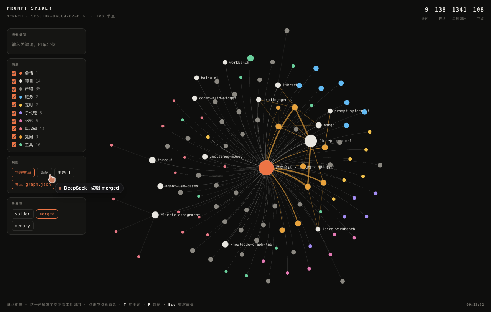

# Prompt Spider UI

把 **agent 会话里的「提问」** 抓成一张蛛网图：中心是会话，每一根蛛丝是一个提问，丝越粗 = 这一问触发了越多次工具调用；提问再连到它真正动过的项目、碰过的文件、用过的工具。

它和工作台里的 **记忆图（`工作台/记忆图/graph.json`）** 用**同一套 data contract**，所以两边可以互相打开、互相合并成一张图——不是两个各说各话的可视化。



## 为什么是「蛛网」而不是又一张力导向图

| 普通力导向图 | 这张蛛网 |
|---|---|
| 节点乱飞，看不出顺序 | 提问按时间顺序沿黄金角螺旋外扩，**越靠外越晚** |
| 边只有"连不连" | 边的粗细 = 工具调用次数，**一眼看出哪几问在干活** |
| 点开是 JSON | 点开是**原话全文** + 这一问用了哪些工具、动了哪些项目/文件 |

## 与记忆图的契约（重要）

两张图都是 `{ W, H, meta, nodes, edges, lists }`：

```jsonc
{
  "W": 1920, "H": 1080,
  "meta": { "session": "...", "records": 10895, "turns": 120, "toolCalls": 1341, "peakContextTokens": 454167, "...": "..." },
  "nodes": [{ "id": 0, "type": "prompt|session|project|artifact|tool|service|schedule|agent|memory|milestone",
              "label": "…", "sub": "…", "x": 0, "y": 0, "r": 4, "weight": 12 }],
  "edges": [{ "s": 0, "t": 1, "w": 1.4 }],
  "lists": { "prompts": [], "projects": [], "artifacts": [], "tools": [], "services": [], "schedules": [], "agents": [], "memory": [], "milestones": [] }
}
```

- 记忆图原有 `type` 一个不改；本工具只**新增** `prompt` / `tool`。记忆图渲染器对未知 type 走 `TYPE[type]?.label` 可选链，所以**直接打开不会崩**（已验证）。
- `meta` 里保留记忆图的同名键（`session / records / turns / userMsgs / toolCalls / peakContextTokens / logBytes`），记忆图那套脚本读蛛网图也能拿到数。
- 反过来：合并时把两个会话 hub 合成为一个中心（`--no-hub-merge` 可关），所以合并图只有**一个太阳**，不会出现两个中心抢视线。

## 三步跑起来

```bash
cd 项目/prompt-spider-ui
node src/extract.mjs                       # 1. 会话日志 → data/prompts.json
node src/spider.mjs                        # 2. → data/spider-graph.json（记忆图 schema）
node src/merge.mjs ../../工作台/记忆图/graph.json data/spider-graph.json -o data/merged.json   # 3. 与记忆图合成一张
node serve.mjs                             # → http://127.0.0.1:8791/
node selftest.mjs                          # 10 条契约断言
```

macOS 双击：`启动PromptSpider.command`（会自己跑完上面 1–3 再开服务）。

## 常用参数

```bash
node src/extract.mjs --all                 # 把 ~/.dsh/sessions 下所有会话都抽进来
node src/extract.mjs --session 890f        # 只抽某个会话（id 片段）
node src/spider.mjs --w 2560 --h 1440      # 换画布尺寸（记忆图默认也是 1920×1080）
node src/merge.mjs A.json B.json --compat memory   # 给只认老 type 的渲染器做兼容映射（prompt→milestone, tool→artifact）
```

## 数据从哪来（不编数据）

`src/extract.mjs` 用 node 内置 `zlib.zstdDecompressSync` 解 `~/.dsh/sessions/<workspace>/session-*/session.v4.jsonl.zstd`，然后：

- **提问** = `type: "user/message"` 里 `content[].text`，并按 21 条系统注入特征（`[SCHEDULE REMINDER`、`Current runtime context`、`A skill is a reusable set of task-specific`、`<system-reminder>`…）过滤——**注入不算提问**，否则蛛网上全是你没说过的话。
- **蛛丝粗细** = 该 turn 里 `type: "tool/call"` 的条数。
- **牵动的项目** = 工具参数里 `项目/<name>` 的出现次数；**碰到的文件** = 带扩展名的文件名。
- **PEAK 上下文** = `assistant/message.data.usage` 的 `inputTokens + cacheReadTokens + cacheWriteTokens` 峰值。

`selftest.mjs` 的 T2 就是专门守这条：任何系统注入混进提问就 fail。

## 界面

- 悬停：高亮这一问的整条链路（会话 → 提问 → 项目），其余淡到 7%
- 点击：右侧面板出**原话全文** + 工具/项目/文件明细
- `T` 切主题，`F` 适配画布，`Esc` 收面板，滚轮缩放，拖拽平移
- 「导出 graph.json」：把当前视图那份图原样下载，**可以直接丢回 `工作台/记忆图/记忆图.html` 打开**

## 已知边界（不吹）

- 提问与项目的归属来自工具参数里的路径字符串匹配，**不是人工确认的强关系**；文件名匹配不上的产物挂在外环。
- 中文提问按"字符截断 46 字"做标签，全文在右侧面板。
- 只读可视化：不改会话日志、不写 `paper_book.json` 之类的业务数据。
- 单会话上千提问时画布会挤，`src/spider.mjs` 默认最多取 400 个提问（`--max-prompts` 可调）。

## License

MIT
